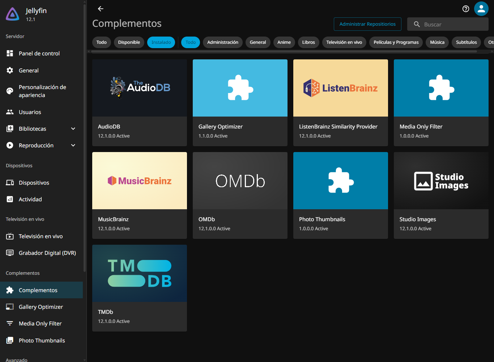

# jellyfin-plugins-repo

Repositorio personal de plugins de Jellyfin. El workflow `publish.yml`
compila los plugins con [jprm](https://github.com/oddstr13/jellyfin-plugin-repository-manager)
y publica `manifest.json` + los `.zip` en GitHub Pages.



## Uso en Jellyfin

**Panel → Plugins → Repositories → +** y añade:

```
https://nen155.github.io/jellyfin-plugins-repo/manifest.json
```

Tras guardar, los plugins aparecerán en el catálogo con instalación y
actualización automática.

## Plugins incluidos

| Logo | Plugin | Descripción | Repositorio |
|---|---|---|---|
|  | Media Only Filter | Ignora en el escaneo archivos que no sean vídeo/imagen, solo en las bibliotecas elegidas. | [Jellyfin.Plugin.MediaOnly](https://github.com/nen155/Jellyfin.Plugin.MediaOnly) |
|  | Gallery Optimizer | Redimensiona en servidor las fotos que el visor pide como original y acota los bitmaps que el carrusel retiene en el cliente — pensado para TVs webOS con poca RAM. | [Jellyfin.Plugin.GalleryOptimizer](https://github.com/nen155/Jellyfin.Plugin.GalleryOptimizer) |
|  | Photo Thumbnails | Genera portadas-collage para carpetas de fotos y pre-genera miniaturas en caché. | [Jellyfin.Plugin.PhotoThumbs](https://github.com/nen155/Jellyfin.Plugin.PhotoThumbs) |

## Otros plugins

Todavía no forman parte de este catálogo; se instalan manualmente compilando el
repositorio y copiando el `.dll` a la carpeta de plugins de Jellyfin.

| Logo | Plugin | Descripción | Repositorio |
|---|---|---|---|
|  | Media Organizer | Normaliza nombres de series y películas para que Jellyfin descargue sus metadatos. | [Jellyfin.Plugin.MediaOrganizer](https://github.com/nen155/Jellyfin.Plugin.MediaOrganizer) |
|  | Photo Guard | Detecta fotos sensibles y las mueve a una bóveda oculta protegida por contraseña. | [Jellyfin.Plugin.PhotoGuard](https://github.com/nen155/Jellyfin.Plugin.PhotoGuard) |
|  | Torrent Search | Buscador de torrents en las webs que configures, con envío directo al cliente de descargas. | Sin publicar |

## Regenerar el repositorio

El workflow se ejecuta semanalmente, en cada push a `main`, o manualmente
desde **Actions → Build plugin repository → Run workflow**. Coge el `main`
de cada repo de plugin, compila con jprm y redeploya el manifest.

Para probarlo en local (necesita .NET 10 y Python 3.8+):

```powershell
pip install jprm
$env:PYTHONUTF8 = "1"   # sin esto, en Windows jprm lee el YAML como cp1252
jprm plugin build .\Jellyfin.Plugin.GalleryOptimizer --output=.\artifacts
jprm repo init .\repo
jprm repo add --url=https://nen155.github.io/jellyfin-plugins-repo .\repo .\artifacts\*.zip
```

## Publicar una nueva versión de un plugin

1. Sube `version` en el `build.yaml` del plugin (y `<Version>` del csproj).
2. Push a `main` del repo del plugin.
3. Ejecuta el workflow de este repo (o espera al cron).
4. Jellyfin ofrecerá la actualización en **Panel → Plugins**.
